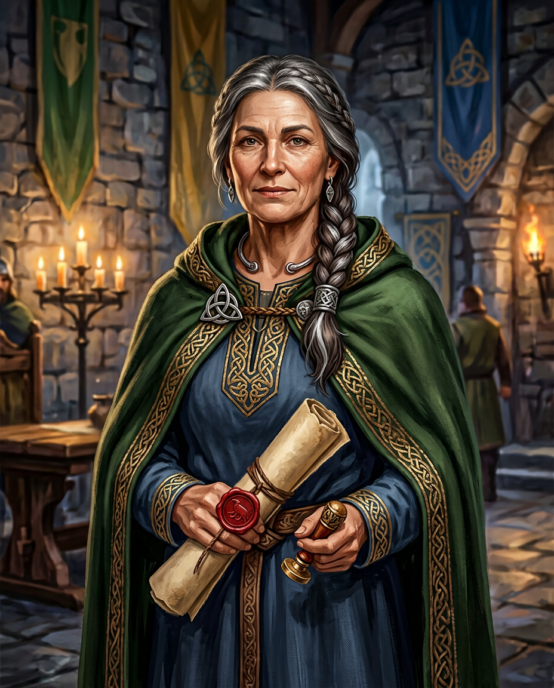

# Перенос «Короны и знамени» в Redot/Godot: подробное руководство

> Практический план миграции браузерного прототипа в нативный 2D-проект. Основной целевой язык — **GDScript**. C# можно выбрать вместо него при наличии команды/кода на .NET, но это не позволит напрямую запустить текущий JavaScript.



## Короткий вывод

Текущая версия — игра в браузере: интерфейс и мир живут в `viewer/game.html`, игровая логика — в `build/_game_runtime.js`, запросы к данным обслуживает `server.mjs`. Внутри используются DOM, CSS, Canvas 2D, `fetch`, `requestAnimationFrame` и `localStorage`. Redot/Godot не исполняет этот игровой runtime как нативный проект.

Переносить следует **правила, данные и ресурсы**, а не пытаться механически переименовать JavaScript в GDScript:

- Изображения PNG/JPG и JSON можно импортировать почти без изменений.
- Игровую логику нужно разделить на GDScript-системы и тестировать по существующим браузерным сценариям.
- HTML/CSS-экран нужно собрать заново из сцен `Control`, а карту — из `Node2D`/`TileMapLayer`.
- `server.mjs` для локального одиночного проекта не нужен: данные читаются из `res://`, сохранения пишутся в `user://`.

Текущий browser baseline также включает авторский SVG-набор из 39 тематических символов `assets/ui/icons/game_icons.svg` вместо системных emoji; в Redot их следует импортировать как векторные ресурсы/Texture2D, не полагаясь на шрифтовой emoji fallback. Есть главное меню с продолжением, созданием отдельной кампании, загрузкой слотов, настройками звука и выходной подсказкой; раздельные уровни master/music/SFX сохраняются в браузере. Web Audio использует процедурные сигналы и фоновую музыку, требующие пользовательского жеста. В тактическом бою есть короткие эффекты атаки/попадания, а карточки победы/отступления/поражения имеют отдельное оформление и `prefers-reduced-motion`; переносить это в нативные UI-сцены и `AnimationPlayer`/Tween, а музыку и эффекты направить через отдельные Audio Bus (Master/Music/SFX) и сохранить уровни через `ConfigFile` в `user://`.

Redot — отдельный форк Godot; используйте одну зафиксированную стабильную версию движка для всего переноса и проверяйте версии импортёра/экспортных шаблонов. Проектный подход Godot обычно применим, но сторонние плагины, экспорт и специфические возможности Redot нужно проверять отдельно. Официальные репозитории: [Redot Engine](https://github.com/Redot-Engine/redot-engine), [Redot docs](https://github.com/Redot-Engine/redot-docs).

## Почему рекомендуется GDScript, а не обязательный C#

| Вариант | Подходит, когда | Что важно для этого проекта |
|---|---|---|
| **GDScript — рекомендуемый старт** | Новый проект в Redot/Godot, небольшая команда, быстрые итерации | Непосредственная работа со сценами, сигналами, `Control`, `TileMapLayer`, `FileAccess`; не требуется .NET toolchain. |
| **C#** | Команда уже пишет на C#, требуется конкретная .NET-библиотека или инфраструктура | Игровые сцены и перенос всё равно придётся переписать; нужно проверить поддержку выбранных платформ, особенно Web/export, в точной версии движка. |
| JavaScript | Нужно оставить текущую игру веб-приложением | Не является обычным встроенным языком игровых скриптов Redot. Можно отдельно размещать веб-версию, но это не эквивалент нативного переноса. |

Официальная документация Redot наследует обучение Godot и отдельно описывает GDScript и C#; руководство рекомендует новичкам начинать с GDScript: [Learn GDScript](https://github.com/Redot-Engine/redot-docs/blob/master/getting_started/introduction/learn_to_code_with_gdscript.rst).

## Что уже есть в прототипе

### Точка входа и логика

- `viewer/game.html` — разметка, стили и синхронизированный inline-runtime браузерной игры.
- `build/_game_runtime.js` — основной runtime: карта, отряды, бой, строительство, экономика, дипломатия, задания, новости, командиры и агенты.
- `server.mjs` — статический сервер-просмотрщик; его маршруты не нужны в локальной Redot-сборке.
- `package.json`, `package-lock.json` — запуск браузерного сервера и инструменты исходного проекта; не заменяют `project.godot`.

### Данные, которые можно импортировать как JSON

- `data/worldmap.json` — карта, сетка, территории, объекты и начальные координаты.
- `data/units_stats.json` — классы войск, параметры, роли, тактики и пути к вариантам иллюстраций.
- `data/class_stats.json`, `data/faction_mods.json` — сводные характеристики классов и фракционные модификаторы.
- `data/equipment_catalog.json` — предметы, слоты, цена и боевые бонусы.
- `data/commanders.json` — командиры, портреты, биографии, характеристики и черты.
- `data/agents.json` — послы, шпионы, разведчики, стоимость найма, способности и портреты.

В JSON используются пути наподобие `assets/factions_armed/...`. В Redot храните их в проекте и переводите в `res://assets/...` при загрузке. Не переименовывайте ID фракций/классов без миграции данных и сохранений.

### Арт-ресурсы

- `assets/worldmap/` — карта мира и отдельные спрайты построек; для замков уровни I–III используют `objects/castle_level_1.png`, `objects/castle_level_2.png` и `objects/castle_sprite.png` соответственно.
- `assets/ui/` — интерфейсные фоны, пользовательские иконки и рамки.
- `assets/factions/`, `assets/factions_armed/`, `assets/factions_bare/` — варианты изображений юнитов.
- `assets/cards/` — карточные изображения для иллюстрированного Кодекса.
- `assets/animations/` — листы/кадры анимаций боевых отрядов.
- `assets/equipment/` — оружие, броня и прочие предметы.
- `assets/commanders/`, `assets/agents/` — портреты командиров и служителей короны.
- `assets/2d_warriors_transparent/` и отдельные корневые PNG — дополнительные иллюстрации персонажей.

**Рыболовные ассеты не входят в комплект.** Не копируйте в Redot-файлы изображения/модели рыболовов, рыб, снастей и рыбалки. В исходной рабочей папке исключены файлы и каталоги, в именах которых есть `fish`, `fisher`, `fishing`, `рыб` или `рыбал`, а также общие ZIP-архивы, содержащие такие модели. См. точный манифест внутри пакета.

## Рекомендуемая архитектура Redot-проекта

Начните с небольшого проекта и не переносите весь браузерный runtime в один гигантский скрипт.

```text
res://
  project.godot
  scenes/
    main/main.tscn
    world/world_map.tscn
    world/unit_token.tscn
    ui/hud.tscn
    ui/news_popup.tscn
    ui/agent_dossier.tscn
    ui/item_dossier.tscn
    ui/encyclopedia.tscn
    combat/battle_screen.tscn
  scripts/
    core/campaign_state.gd
    core/save_service.gd
    data/game_data.gd
    world/world_map.gd
    world/unit_token.gd
    systems/turn_system.gd
    systems/economy_system.gd
    systems/building_system.gd
    systems/diplomacy_system.gd
    systems/agent_system.gd
    systems/quest_system.gd
    systems/battle_system.gd
    ui/hud_controller.gd
  data/                       # копия JSON из браузерного проекта
  assets/                     # выбранные PNG/JPG/анимации/модели без fishing assets
  tests/
    smoke_campaign.gd
    test_data_integrity.gd
```

### Ответственность систем

- **CampaignState (Autoload/сервис):** активная фракция, ход, год, ресурсы, отношения, армия, здания, задания, агенты.
- **GameData:** чтение JSON и проверка обязательных ключей/путей изображений.
- **WorldMap:** сетка 45×30; координаты тайла; отрисовка регионов, объектов и выбранных отрядов. В браузерном прототипе `TILE = 64`, поэтому размер логической карты — 2880×1920 пикселей при масштабе 1:1.
- **TurnSystem:** продвижение игрового дня, производство, расход провианта, сроки заданий, возвращение агентов и cooldown.
- **BuildingSystem / EconomySystem:** цены строительства/улучшения и производство зданий.
- **DiplomacySystem:** война, мир, торговля, союзы, браки и отношения.
- **AgentSystem:** найм, миссии, риск, разведданные, опыт, уровни и бонусы.
- **QuestSystem:** условия, сроки, исходы и награды поручений.
- **BattleSystem:** раунды, приказы, урон, потери, победа/отступление/поражение.
- **HUD/Popup:** только отображение и пользовательский ввод; важные правила не должны находиться в коде кнопок.

## Перенос по этапам

### Этап 0 — зафиксировать базу и выбрать версию

1. Сохранить исходный браузерный проект отдельно и не менять ID данных без причины.
2. Создать новый каталог Redot-проекта рядом, а не поверх `viewer/game.html`.
3. Зафиксировать точный номер версии Redot и экспортных шаблонов в README проекта.
4. Установить редактор Redot, matching export templates и Git. Начать с Desktop-профиля, не добавлять внешние плагины без необходимости.
5. Принять решение по языку. Для этого проекта — GDScript; смешивать GDScript и C# в первом этапе не нужно.

**Готово, когда:** пустой проект запускается на целевой ОС; выбранная версия и способ экспорта записаны.

### Этап 1 — создать чистый Redot-проект и импортировать ресурсы

1. Создать `project.godot`, `scenes/main/main.tscn` и базовую сцену `Node2D` + `CanvasLayer`.
2. Скопировать только перечисленные в `PACK_MANIFEST_RU.md` игровые данные и арт-файлы.
3. Сначала импортировать карту, UI, несколько юнитов, одну постройку, портрет командира и три портрета агентов.
4. Проверить `Texture2D`, прозрачность PNG, поворот/масштаб и filtering. Для рисованных портретов обычно подойдёт linear filtering; pixel-art фильтр выбирать только при реальном пиксельном стиле.
5. Не переносить `node_modules`, `.venv`, `.git`, `.cache`, Python cache, debug-preview и fishing assets.

**Готово, когда:** проект открывает все пробные файлы без import errors; ни одна сцена не зависит от абсолютного пути браузерного сервера.

### Этап 2 — перенести загрузку данных

1. Перенести JSON в `res://data/` и реализовать единый `GameData`.
2. На загрузке проверить, что есть 5 фракций, корректные ID классов, непустые характеристики и существующие пути изображений.
3. Проверить каждый путь из `units_stats.json`, `equipment_catalog.json`, `commanders.json`, `agents.json` и `worldmap.json`.
4. В случае ошибки показывать диагностическое сообщение с файлом и JSON-путём; не подменять битые данные молча.
5. Данные после чтения хранить в словарях/массиве состояния; не перечитывать JSON на каждый кадр.

Пример загрузчика:

```gdscript
func load_json(relative_path: String) -> Variant:
    var path := "res://" + relative_path.trim_prefix("/")
    if not FileAccess.file_exists(path):
        push_error("JSON не найден: " + path)
        return null

    var file := FileAccess.open(path, FileAccess.READ)
    if file == null:
        push_error("Не удалось прочитать: " + path)
        return null

    var parser := JSON.new()
    var error := parser.parse(file.get_as_text())
    if error != OK:
        push_error("JSON parse error в %s, строка %d: %s" % [path, parser.get_error_line(), parser.get_error_message()])
        return null
    return parser.data
```

**Готово, когда:** данные загружены, а автоматическая проверка сообщает об отсутствующих файлах/ключах.

### Этап 3 — собрать карту и управление камерой

1. Импортировать `assets/worldmap/overland_map.png` как фон карты.
2. Использовать значения сетки из `worldmap.json` (`cols`, `rows`, `tile_px`), не дублировать их вручную в нескольких системах.
3. Использовать `TileMapLayer` для terrain/ownership либо отдельный `Node2D` overlay; спрайты объектов рендерить отдельными сценами.
4. Переводить координаты тайла в позицию мира единым helper-методом.
5. Добавить pan/zoom камеры, minimap, выделение объекта/отряда и правила свободной/непроходимой клетки.
6. Не смешивать художественную карту с логической сеткой: картинка может быть декоративной, а walkability/ownership читается из JSON.

**Готово, когда:** карта 45×30 открывается; столицы/объекты стоят на правильных клетках; можно масштабировать и перемещать камеру.

### Этап 4 — перенести отряды и приказы

1. Сделать сцену `unit_token.tscn` на основе `Node2D` с `Sprite2D`, маркером фракции и кнопкой/областью выбора.
2. Данные экземпляра отделить от визуального узла: ID класса, фракция, численность, мораль, координата, экипировка, маршрут.
3. Перенести выбор отряда, перемещение и маршруты. Для первого этапа достаточно простого BFS по 4 соседям; позже можно перейти на `AStarGrid2D`. Сохранять режим марша на каждом отряде: обычный или форсированный (+35% скорости, +25% усталости на то же расстояние); учитывать его вместе с рельефом и бонусом командира.
4. Не хранить ссылки на UI-контролы внутри unit-модели.
5. Проверить, что враги не становятся дружескими при смене активной фракции и что маршруты не проходят через воду/горы/строения.

**Готово, когда:** можно выбрать свой отряд, увидеть его карточку и отдать приказ перемещения.

### Этап 5 — ход, ресурсы и сохранение

1. Перенести один ход в отдельную функцию `advance_turn()` с фиксированным порядком расчётов.
2. Учитывать базовый доход, производство по уровням зданий, торговые договоры, содержание/голод и смену года.
3. Вести `campaign_turn` как монотонный счётчик; не использовать только номер дня, так как день сбрасывается при новом году.
4. Записывать сохранение в `user://crown_banner_save.json` через `FileAccess` + `JSON.stringify()`.
5. Добавить `save_version` и миграцию старых сохранений: поля с новыми системами должны получать безопасные defaults.
6. Сохранять только игровое состояние, а не сцены/UI/текстуры.

**Готово, когда:** перезапуск сохраняет день, ресурсы, армию, здания, дипломатию, командиров, агентов, задания и разведданные.

### Этап 6 — стройка, найм и улучшения

1. Перенести каталог шести типов построек и цены.
2. Строительство: выбрать проект → проверить территорию/тайл/ресурсы → списать ресурсы → ждать 2 игровых дня → добавить здание.
3. Добавить уровни зданий 1–3 и отображение уровня на карте. Замки используют `castle_level_1.png`–`castle_sprite.png`, города — `town_level_1.png`–`town_level_3.png`, фермы/рынки/казармы — оригинальный `*_sprite.png` как уровень I и варианты `*_level_2.png`, `*_level_3.png`. Используй alpha-прозрачность, общий pivot и отображай уровень структуры.
4. Производство улучшать формулой, согласованной с текущими правилами: ферма +12 зерна/день за уровень, лесопилка +5 древесины, каменоломня +4 камня, рынок +8 золота.
5. Перенести набор регулярных войск и наёмников, проверяя ресурсы и население перед тратой.
6. При нескольких однотипных зданиях проверять, что доход суммируется по каждому экземпляру.
7. На вкладке королевства показывать остатки и чистый дневной поток зерна/древесины/камня/золота, с разбиением на основу, здания, указы, местное развитие, торговлю, бонус командира и содержание армии. Один зерновой паёк на 50 своих бойцов расходуется ежедневно; при дефиците предупреди игрока, обнули остаток зерна, а низкие запасы должны влиять на мораль/болезни. Показывать годовое зерновое содержание населения отдельно от ежедневного армейского пайка; UI и ход должны использовать один общий расчёт прогноза дохода.
8. В панели найма до подтверждения показывать точные цены золота, зерна и населения, используемые той же функцией проверки/списания. На карточках поселений показывать местный доход и действие фокусировки карты. В торговой карточке — доход конкретного договора и пометку об остановке торговли во время войны. При добровольном расторжении сразу прекратить доход, снизить отношения на 18 и сохранить `trade_embargo_until = campaign_turn + 3`; показывать остаток бойкота и запрещать игроку/AI/послу открывать новый маршрут до срока.
9. Показать рабочие строительные проекты, оставшиеся дни и кнопку фокусировки камеры на площадке; проект и таймер должны сохраняться.
10. Разрешить улучшать подконтрольные города/замки до уровня III за древесину, камень и золото; срок — два хода. Держать отдельные settlement-project данные в общей очереди, отменять проект при утрате поселения, сохранять очередь и увеличивать местное производство при завершении. Для города tier добавляет золото, для замка — зерно и камень; завершение сопровождается иллюстрированной новостью `assets/events/settlement_upgrade.jpg`.

**Готово, когда:** строительство и улучшение поселения завершаются через два хода, потраченные ресурсы/уровни/очереди сохраняются; казначейский прогноз совпадает с начислениями игрового хода.

### Этап 7 — дипломатия и договоры

1. Перенести отношение державы, мир/войну, торговлю, союз и династический договор как независимые поля.
2. Проверять стоимость решения до его применения; при нехватке ресурсов не менять отношения частично.
3. Война отключает торговлю и военный союз; мир восстанавливает состояние войны, но не должен автоматически возвращать все старые договоры.
4. Торговый доход начислять один раз за ход и только если стороны не воюют.
5. Новости дипломатии оформлять как отдельные UI-события с результатом, а не как единственную всплывающую строку.
6. Добавить подтверждение для объявления войны/расторжения; показывать стоимость и ожидаемый эффект до клика. Расторжение торговли должно ясно объяснять потерю текущего дневного дохода, −18 отношений и трёхходовой купеческий бойкот; бойкот сохраняется и блокирует повторные предложения игрока, AI и посла.

**Готово, когда:** тестируются мир, торговля, союз, война, расторжение, отказ/успех посольства и загрузка сохранения.

### Этап 8 — послы, шпионы, разведчики

1. У каждого агента хранить `hired`, `level`, `xp`, `ready_turn` и идентификатор роли.
2. Посол: улучшает отношения, предлагает торговый путь и повышает шанс мира.
3. Шпион: тайная операция с шансом успеха; успех приносит золото/сведения, провал вызывает ухудшение отношений и более долгий cooldown.
4. Разведчик: записывает численность противника и `scouted_until`, фокусирует карту на державе и даёт временный бонус атаке против неё.
5. Каждая миссия имеет стоимость/риск/срок возвращения; эффекты не должны применяться повторно при загрузке сохранения.
6. Опыт повышает уровень и вероятность/силу ролевого умения; отображать XP-bar, готовность и следующее усиление.
7. Портрет, описание, умение и риск использовать в Совете и в иллюстрированном Кодексе.

**Готово, когда:** все три агента нанимаются, выполняют разные миссии, имеют cooldown и сохраняются/загружаются.

### Этап 9 — задания, городские события и новости

1. У задания есть стабильный ID, условие, принятый ход, абсолютный deadline, статус и одноразовая награда.
2. Задание проверяется после конкретного игрового события: завершение постройки, союз, победа.
3. События двора показывать как `PopupPanel` или самостоятельную `Control`-сцену с вариантами, ценой, последствиями и опциональной иллюстрацией. Браузерный срез содержит арт беженцев/посольства/амбара (`court_*.jpg`), нехватки продовольствия (`food_shortage.jpg`), мятежа (`settlement_revolt.jpg`) и успешного перемирия (`peace_treaty.jpg`) в `assets/events/`.
4. Всплывающее окно не должно блокировать всю игру бесконечно; поддержать кнопку закрытия, паузу при выборе и `prefers-reduced-motion`-аналог через настройку анимации.
5. Новости договора, построек, найма, завершения задания, итога боя и годового совета сохранять в летописи. После каждого восьмого игрового дня публиковать сводку войн, договоров, войска, торговли, поселений и казны; заголовки вращать между темами, а данные собирать из текущего состояния.
6. Разделить popup-контроллер и логику выбора: UI отправляет сигнал, система меняет `CampaignState`. Все новости проводить через FIFO-очередь, чтобы сообщения не перезаписывали открытый popup.
7. Сохранять `last_annual_news_year`, чтобы загруженная кампания не показывала годовую сводку повторно.

**Готово, когда:** решение события меняет ресурсы только один раз; новости показываются последовательно; годовой отчёт отражает текущее состояние и не дублируется после загрузки; поручения не просрочиваются неправильно при смене года.

### Этап 10 — бой, рост и навыки

1. Перенести бой как конечный автомат: `player_turn`, `enemy_turn`, `victory`, `defeat`, `retreat`.
2. Разделить боевые группы, расчёт атаки/защиты, экипировку, командирские бонусы, временный бонус разведки и построение дружины. Сохранить «Линию» (без модификатора), «Стену щитов» (+15% защиты/−12% атаки) и «Клин» (+12% атаки/−5% защиты, кавалерии дополнительно +8% атаки); выбранный строй отряда хранить в save data.
3. Записывать фактические потери до изменения количества; выдавать награду/опыт ровно один раз.
4. Добавить итоговую карточку с потерями, добычей и опытом; использовать отдельные иллюстрации `assets/events/battle_victory.jpg` и `battle_defeat.jpg` для победы и поражения/отступления.
5. Выбирать боевую сцену по месту столкновения: переправа, лесная засада, оборона моста или осада вражеского замка/города/крепости. Для осады использовать `assets/battle_scenarios/fortress_siege.jpg`, рисовать стены и ворота на тактическом поле, давать гарнизону +15% защиты и атакующей коннице −8% атаки; показывать модификаторы до приказа.
6. Подключать анимации из `assets/animations/` только после завершения логического цикла и fallback-спрайта.
7. Проверить случайность боя seed-ом или фиксированным RNG в тестах.

**Готово, когда:** проходят победа, поражение, отступление, гибель отряда, XP командира/агента и загрузка сохранённого результата.

### Этап 11 — Кодекс и финальная интеграция

1. Загрузить иллюстрации из `assets/cards/` и данные из `units_stats.json`.
2. Фильтровать по фракции/типу/варианту, не загружая все крупные изображения на экран одновременно.
3. Добавить досье командиров, агентов, предметов, зданий и фракций; каждая запись должна вести к тем же ID, что и логика кампании.
4. Включить «Государственный совет», «Армию», «Кодекс», «Задания», «Стройку», «Дипломатию» как отдельные панели или сцены.
5. Перенести стартовое меню и шаг выбора фракции до запуска новой кампании: показать пять знамён, названий и столиц, подтверждение/возврат; выбранный ID должен задавать стартовые позиции/столицу и попадать в сохранение.
6. Сохранить медиапеременные/узкие разрешения: панели не должны закрывать карту целиком, если это не модальное событие.

**Готово, когда:** главная кампания и досье используют единый набор данных и корректные портреты.

### Этап 12 — экспорт и тестирование

- Запускать проект редактором и headless-режимом выбранного Redot; отдельно проверить экспортные templates.
- Проверить все JSON-ссылки на текстуры, отсутствующие файлы, кириллицу, шрифты и мобильные соотношения сторон.
- Пройти acceptance checklist ниже на чистом сохранении и существующем сохранении.
- Зафиксировать версию движка, инструкции запуска, список исключённых fishing assets и известные ограничения.

## Соответствие браузерных частей узлам Redot

| Сейчас в браузере | Целевой Redot/Godot-компонент |
|---|---|
| `viewer/game.html` и CSS | Сцены `Control`, `PanelContainer`, `TabContainer`, `PopupPanel`, `AnimationPlayer` |
| HTML Canvas карты | `Node2D`, `TileMapLayer`, `Sprite2D`, `Camera2D` |
| `drawImage()` и image cache | `Sprite2D.texture`, `Texture2D`, `ResourceLoader` |
| `fetch('/data/x.json')` | `FileAccess.open('res://data/x.json')` + `JSON` |
| `localStorage` | `FileAccess` на `user://...` |
| `requestAnimationFrame` | `_process(delta)`/`_physics_process(delta)` только для визуального движения |
| JS `onclick`/DOM | Godot signals (`pressed`, `item_selected`, пользовательские сигналы) |
| случайное число `Math.random()` | `RandomNumberGenerator` с seed для повторяемых тестов |
| `setTimeout` | `Timer` node / `SceneTreeTimer`; не использовать таймеры браузерного runtime |
| `server.mjs` | Не нужен в локальной одиночной игре; позже отдельный API только для сетевых функций |

## Минимальный критерий первой рабочей версии

Не переносить все 75 классов, сотни карточек и весь баланс за один заход. Первый вертикальный срез считается пригодным, если:

1. Запускается чистый Redot-проект без сервера Node.
2. Отображается карта и столица; карта zoom/pan работает.
3. Можно нанять и выбрать один отряд.
4. Можно переместить его по проходимым клеткам.
5. Можно построить ферму, провести 2 хода и увидеть производство.
6. Сохранение и загрузка восстанавливают состояние.
7. Нет рыболовных ассетов в проекте, архивах и references.

Затем добавлять системы по одной, не закрывая следующий этап, пока критерии предыдущего не проверены.

## Итоговый acceptance checklist

- [ ] `project.godot` открывается в выбранной версии Redot; все сцены загружаются.
- [ ] Все JSON проходят parse, связи по ID целостны, каждая указанная текстура существует.
- [ ] Сетка и позиции мира совпадают с `worldmap.json`.
- [ ] Отряды нельзя переместить за карту, через воду/горы или запрещённую постройку.
- [ ] Ресурсы не уходят в минус; цена проверяется до операции.
- [ ] Торговля, война и мир меняют состояние и суточный доход корректно.
- [ ] У агента и командира опыт/уровни не дублируются после загрузки.
- [ ] Задания считают абсолютное время и однократно выдают награды.
- [ ] События и popups имеют закрытие/выбор, а новости попадают в летопись.
- [ ] Победа, поражение и отступление фиксируют правильные потери.
- [ ] Старое сохранение получает безопасные значения новых полей.
- [ ] В исходниках, data, пакетах и проекте отсутствуют рыболовные ассеты.

## Полезные ссылки

- [Redot Engine — официальный GitHub](https://github.com/Redot-Engine/redot-engine)
- [Redot documentation — репозиторий документации](https://github.com/Redot-Engine/redot-docs)
- [Redot docs: GDScript для начинающих](https://github.com/Redot-Engine/redot-docs/blob/master/getting_started/introduction/learn_to_code_with_gdscript.rst)
- [Godot документация по загрузке/сохранению файлов](https://docs.godotengine.org/en/stable/tutorials/io/saving_games.html) — API проверяйте по версии Redot.
